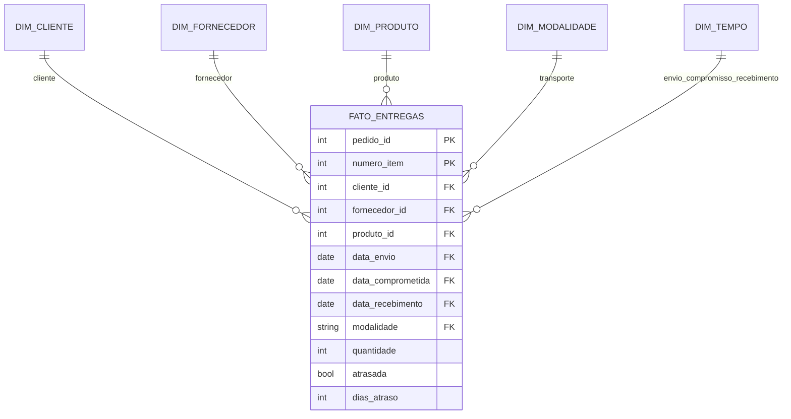

# Modelo dimensional e representação documental

## Modelo estrela conceitual



Grão: **um item de pedido**, definido por `(l_orderkey, l_linenumber)`. Um pedido pode ter vários itens, fornecedores e datas. O nome da coleção não muda esse grão. O identificador do pedido é uma dimensão degenerada na fato.

A dimensão tempo exerce três papéis: envio, compromisso e recebimento. O mês das consultas corresponde ao compromisso. As dimensões necessárias são cliente (segmento, país, região), fornecedor (identificador, nome, país, região), produto (marca e tipo), modalidade e tempo. A fato mantém quantidade e dias de atraso, e o indicador booleano permite contar atrasados.

## Relacionamentos da origem

| Relacionamento | Chaves |
|---|---|
| Item / pedido | lineitem.l_orderkey = orders.o_orderkey |
| Pedido / cliente | orders.o_custkey = customer.c_custkey |
| Cliente / país / região | customer.c_nationkey = nation.n_nationkey e nation.n_regionkey = region.r_regionkey |
| Item / fornecedor | lineitem.l_suppkey = supplier.s_suppkey |
| Fornecedor / país / região | supplier.s_nationkey = nation.n_nationkey e nation.n_regionkey = region.r_regionkey |
| Item / produto | lineitem.l_partkey = part.p_partkey |
| Integridade item / fornecimento | (l_partkey,l_suppkey) referencia partsupp(ps_partkey,ps_suppkey) |

A extração usa aliases separados para geografia do cliente e fornecedor. LEFT JOIN conserva eventuais órfãos para rejeitá-los explicitamente, evitando perda silenciosa de fatos. Não há necessidade de extrair medidas de partsupp para o indicador de atraso.

## MongoDB: embedding

A coleção física é `tpch_bi.fato_entregas`. As dimensões ficam incorporadas. Essa escolha permite filtrar e agregar os atributos necessários sem `$lookup`, simplifica a demonstração e mantém cada item interpretável. O custo é repetir descrições dimensionais. Atualizações em dimensões exigem nova carga. Os dados analíticos representam o snapshot atual do TPC-H e não implementam histórico SCD tipo 2.

```javascript
{
  _id: "pedido:item",
  pedidoId: NumberInt(...),
  numeroItem: NumberInt(...),
  datas: { envio: ISODate(...), comprometida: ISODate(...), recebimento: ISODate(...) },
  entrega: { modalidade: "...", atrasada: true, diasAtraso: NumberInt(...) },
  cliente: { id: ..., segmento: "...", nacao: "...", regiao: "..." },
  fornecedor: { id: ..., nome: "...", nacao: "...", regiao: "..." },
  produto: { id: ..., marca: "...", tipo: "..." },
  quantidade: NumberInt(...)
}
```

O exemplo acima descreve a estrutura, sem resultados fictícios. Um documento real é exportado para artifacts/documento_exemplo.json.

Não é necessário implementar coleções dim_* físicas para demonstrar o modelo estrela conceitual. Referencing exigiria junções nas consultas e seria útil para dimensões compartilhadas ou muito mutáveis. O embedding atende ao recorte escolhido e ao volume do protótipo, sem afirmar superioridade de desempenho medida.

Índices: `_id` único, data comprometida, modalidade, fornecedor e região do cliente. Eles apoiam filtros futuros. Agregações completas podem ler toda a coleção, mesmo com índices.

## Carga e validação

O ETL monta uma coleção temporária única por execução, trata e calcula os campos, verifica contagens e publica por renomeação atômica. Falhas anteriores à publicação preservam a carga anterior. A validação independente calcula atraso em SQL, compara todos os atributos por chave e confere as somas gerais e os grupos de modalidade/mês. Não basta comparar apenas o total de documentos.
